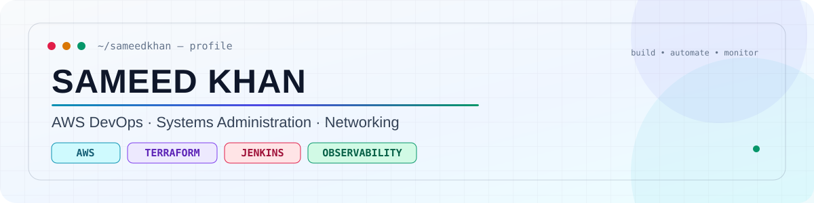

<picture>
  <source media="(prefers-color-scheme: dark)" srcset="./dark.svg">
  <source media="(prefers-color-scheme: light)" srcset="./light.svg">
  
</picture>

  

  
  
  

## About Me

Hi, I'm **Sameed Khan**, a systems and networking professional building practical skills in **AWS DevOps**. My background includes Windows and Linux administration, network connectivity troubleshooting, user access and permissions, and infrastructure support. In my hands-on projects, I use **Terraform** to define AWS infrastructure, **Jenkins** to automate build and infrastructure-check pipelines, and **Prometheus + Grafana** to monitor EC2 systems.

I like solving infrastructure problems step by step, documenting what I build, and improving the repeatability and security of cloud environments.

## Technical Skills

### AWS Cloud & Infrastructure as Code

- **AWS:** EC2, VPC, public/private subnets, route tables, Internet Gateway, NAT Gateway, Security Groups, Application Load Balancer, RDS MySQL, IAM roles, S3, Lambda and Systems Manager.
- **Terraform:** variables, outputs, state concepts, S3 remote-backend concepts and versioning, root/child and Registry modules, data sources, `count`, `for_each`, dynamic blocks, and `local-exec`/`remote-exec` provisioners.

### CI/CD, Monitoring & Logging

- **CI/CD:** Jenkins declarative pipelines/Jenkinsfile, Maven build/test/package workflow, JAR artifact archiving, GitHub webhooks, and Terraform `fmt`, `validate` and `plan` checks.
- **Monitoring & logging:** Prometheus, Node Exporter, Grafana dashboards, CPU/memory/disk metrics, server availability, Splunk Universal Forwarder and Splunk indexer.

### Systems, Scripting, Applications & Networking

- **Systems:** Linux (Ubuntu/Amazon Linux), Windows, systemd, user permissions, package management and system logs.
- **Scripting & tools:** Bash, Python, Boto3 and AWS CLI.
- **Applications & databases:** Nginx reverse proxy, Flask and MySQL.
- **Networking:** TCP/IP, DNS, DHCP, HTTP/HTTPS, SSH, routing, switching, LAN/WAN, CIDR/subnetting, NAT and load balancing.

## Featured Projects

| Project | What it demonstrates |
|:--|:--|
| [**AWS EC2 Monitoring — Prometheus & Grafana**](https://github.com/Sameedkhan469/Grafana-Prometheus) | Terraform-managed AWS network and two Ubuntu EC2 instances; Prometheus, Node Exporter and Grafana dashboards for CPU, memory, disk and availability. The README notes that the services are installed directly on Ubuntu, not Docker. |
| [**Multi-Tier E-Commerce on AWS**](https://github.com/Sameedkhan469/sameed-ecommerce-aws-terraform) | Terraform-defined Nginx frontend, private Flask backend and private RDS MySQL database, tier-specific Security Groups, NAT routing and Systems Manager access. |
| [**AWS Three-Tier Infrastructure**](https://github.com/Sameedkhan469/Terraform-Three-Tier-Project) | Terraform configuration for a VPC, eight tier-specific subnets across two Availability Zones, HTTP Application Load Balancer, Nginx frontend EC2 instances, backend instances and private RDS MySQL. This is an infrastructure learning project; the repository documents that the complete frontend-to-backend application workflow is not yet implemented. |
| [**Jenkins CI/CD + Terraform**](https://github.com/Sameedkhan469/jenkins-cicd-practice) | Jenkins pipeline for Terraform checkout, init, format, validate and plan steps, plus Terraform configuration for AWS infrastructure hosting Jenkins. |
| [**Maven Build Pipeline**](https://github.com/Sameedkhan469/sameed-maven-project) | Maven Java project with a Jenkinsfile for compile, test and package stages, with JAR artifact archiving and success/failure handling. |
| [**Terraform Practice Labs**](https://github.com/Sameedkhan469/terraform-practice) | Daily hands-on labs including state/backend concepts, EC2, modules, provisioners, `null_resource`, dynamic Security Group rules, `count` and `for_each`. |
| [**Linux Commands for DevOps & Cloud**](https://github.com/Sameedkhan469/Linux-commands) | A reference for Linux file and user management, permissions, processes, packages, networking, storage, monitoring, services, shell scripting, logs and common DevOps commands. |

## Professional Experience

- **Networking Engineer — F2TH Communication Private Ltd** · Bengaluru, India · 8 months  
  Troubleshooting connectivity, routing, IP addressing, DNS/DHCP and TCP/IP; configuring and troubleshooting network devices; investigating infrastructure faults.
- **System Administrator — DN Computers** · 1 year 6 months  
  Windows/Linux administration, software installation and updates, user accounts and permissions, operating-system and hardware troubleshooting, file sharing, backups and basic security controls.

## Education & Training

- **Bachelor of Computer Applications (BCA)** — Arunodaya University · 2021–2024
- **Diploma in Cloud Computing** — Jetking
- **AWS Solutions Architecture Job Simulation** — Forage

## Next Learning Goals

I am strengthening my practical DevOps toolkit in the next stages:

- Docker and Docker Compose
- Kubernetes fundamentals and AWS EKS
- Ansible for configuration management
- End-to-end CI/CD deployment and release practices

These are learning goals, not a claim that these tools are already demonstrated in the featured repositories.

## GitHub Stats

  
  
   
  

## Contribution Snake

  <picture>
    <source media="(prefers-color-scheme: dark)" srcset="https://raw.githubusercontent.com/Sameedkhan469/Sameedkhan469/output/github-contribution-grid-snake-dark.svg" />
    <source media="(prefers-color-scheme: light)" srcset="https://raw.githubusercontent.com/Sameedkhan469/Sameedkhan469/output/github-contribution-grid-snake.svg" />
    
  </picture>

> The contribution animation is generated by the GitHub Actions workflow in `.github/workflows/snake.yml`. It will appear after the workflow runs successfully and publishes the `output` branch.

## Connect

  
  

<b>Build • Automate • Deploy • Monitor</b>

