<a href="https://github.com/Sameedkhan469">
  
</a>

  
  
  
  
  


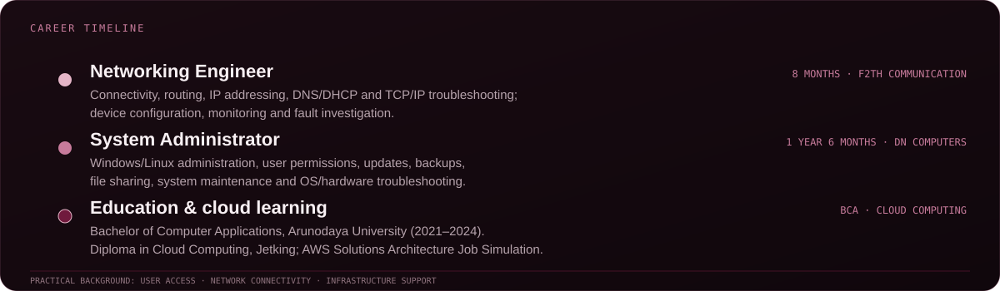

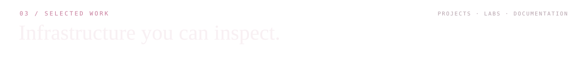

<a href="https://github.com/Sameedkhan469/Grafana-Prometheus"></a>

  

<a href="https://github.com/Sameedkhan469/sameed-ecommerce-aws-terraform"></a>

  

<a href="https://github.com/Sameedkhan469/Terraform-Three-Tier-Project"></a>

  

<a href="https://github.com/Sameedkhan469/jenkins-cicd-practice"></a>

  
  

<a href="https://github.com/Sameedkhan469/terraform-practice"></a>

  

<a href="https://github.com/Sameedkhan469/Linux-commands"></a>

  

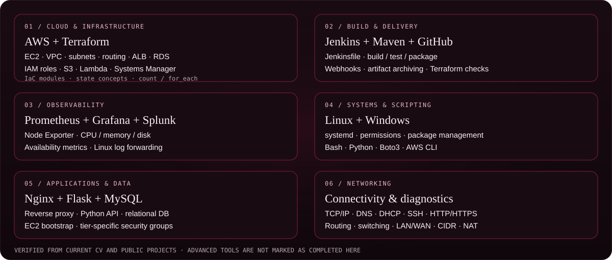


<a href="https://github.com/Sameedkhan469">
  
</a>

  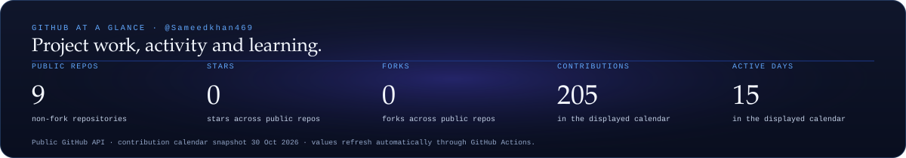

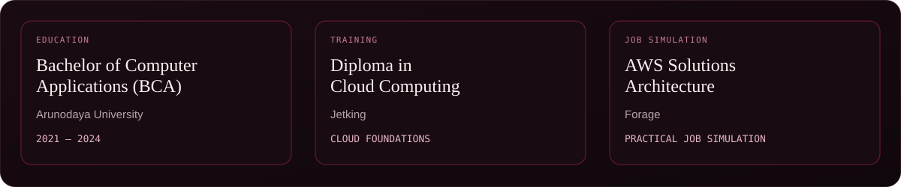

  
  
  

  <em>These are next learning goals, not claims of completed production experience.</em>


  
  
  

<a href="https://github.com/Sameedkhan469">
  
</a>

Profile details and project descriptions are based on my CV and linked repositories. Project descriptions distinguish infrastructure labs from complete production applications.

